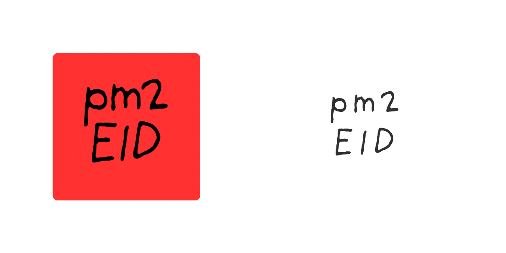

# PM2 EID Dashboard




[](https://github.com/core-red-project/pm2-eid-is-discord/actions/workflows/ci.yml)

[](https://www.npmjs.com/package/@sxnnyside/pm2-eid-dashboard)
[](https://discord.gg/h3hhNY8VTE)
[](https://patreon.com/SxnnysideProject)

<p align="center">
  <strong>Lightweight ✦ Self-Hosted ✦ Docker-Ready</strong><br>
  <em>Minimal, secure PM2 process management console and real-time supervisor.</em>
</p>

<p align="center">
  <a href="#about">About</a> ✦
  <a href="#features">Features</a> ✦
  <a href="#installation">Installation</a> ✦
  <a href="#usage">Usage</a> ✦
  <a href="#architecture">Architecture</a> ✦
  <a href="#contributing">Contributing</a>
</p>

---

## About

**PM2 EID Dashboard** is a lightweight, dockerizable web management console and real-time event supervisor for PM2 process infrastructure.

Traditional PM2 monitoring options are often tied to cloud subscriptions, heavy runtimes, or abandoned projects. PM2 EID Dashboard provides a self-contained, offline-first dashboard that interacts directly with the local PM2 daemon over domain sockets without external telemetry.

It combines an ultra-fast Bun and Node.js 20+ backend using Hono and HTMX, streaming process controls, tail logs, and host telemetry with zero client framework bloat.

### Philosophy

> *"Operational infrastructure should be fast, self-contained, and devoid of cloud dependencies."*

Part of the Core Red Project realm within the Sxnnyside Project ecosystem.

## Features

- **Process Supervision**: Real-time process monitoring (CPU, memory, restarts, uptime) with Start, Stop, Restart, Reload, Delete, and Cluster Scaling controls.
- **Anti-OOM Log Tailing**: Safe tailing of stdout and stderr directly in the browser reading up to 256 KB without loading multi-gigabyte files into memory.
- **1-Hour In-Memory Metrics History**: Volatile RAM ring buffer rendering zero-JS inline SVG sparklines for host CPU and memory trends without databases or disk overhead.
- **Smart Crash Loop Alerts**: Detects rapid restart loops (`unstable_restarts`), throttling repetitive spam and dispatching high-priority embeds to Discord or Slack.
- **Stylized Discord Webhooks**: Aesthetic, rich Discord embeds with status emojis, execution metrics, and diff-formatted stderr stack traces.
- **Host Hardware Telemetry**: Live System Metrics widget reporting host CPU utilization, memory consumption, load averages, and uptime.
- **State Persistence**: Single-click toolbar button to commit process definitions to disk (`pm2 save`).
- **Deep Process Diagnostics**: Detailed modal (`pm2.describe`) exposing PIDs, CWD, Git versioning, masked environment variables, and `axm_monitor` metrics.
- **Multi-Language Support (i18n)**: Native English and Spanish catalogs with negotiation via `Accept-Language`, cookie, or `?lang=` override.
- **Zero Telemetry & Auditable**: Single outbound network destination strictly limited to the operator's configured webhook, backed by automated CI audit tests.
- **Secure by Default**: Cookie session authentication with server-side revocation, brute-force rate limiting, and strict CSP without `'unsafe-inline'`.

## Installation

### Prerequisites

- Node.js (>= 20.0.0) or Bun (>= 1.4.0) or Docker
- PM2 (>= 5.4.0) running on host or container environment

### Instant Execution (npx / bunx)

Run the dashboard instantly on any server without cloning the repo:

```bash
# With Node.js
npx @sxnnyside/pm2-eid-dashboard

# With Bun
bunx @sxnnyside/pm2-eid-dashboard
```

### From Source

```bash
git clone https://github.com/core-red-project/pm2-eid-is-discord.git
cd pm2-eid-is-discord

just install
just dev
```

### Docker Deployment

```bash
# Using Docker Compose mounting the host PM2 daemon
docker compose up -d --build
```

## Usage

```bash
# Start development server with hot-reload
just dev

# Production build
just build

# Verify production distribution bundle under Node.js
just verify-dist

# Run complete quality gate (format, lint, typecheck, test)
just check

# Launch mock test processes for local development
just fixtures-start

# Stop and tear down mock test processes
just fixtures-stop
```

## Privacy & Zero Telemetry Guarantee

PM2 EID Dashboard is built with an auditable, privacy-first architecture:
- **No Third-Party Analytics**: Contains zero telemetry, tracking SDKs, or background ping servers.
- **Single Outbound Destination**: The only outbound network connection ever made by this software is to the `WEBHOOK_URL` explicitly configured by the operator.
- **Zero Remote Assets**: All styles, icons, and JavaScript libraries (HTMX) are bundled locally in `public/` — zero calls to external CDNs.
- **PM2 Daemon Telemetry Disabled**: `pm2-eid` itself never transmits data. By default, the upstream PM2 daemon performs an automated version check to `version.pm2.io`. PM2 EID explicitly disables this outbound call by enforcing `PM2_DISABLE_VERSION_CHECK=1` across the server runtime, `Dockerfile`, `Dockerfile.node`, and `docker-compose.yml`.
- **Enforced by Automated CI Test**: Continuously verified by `test/privacy-audit.test.ts`, which scans the entire codebase during `just check` to ensure no `fetch()`, `https.get()`, `http.request()`, or `WebSocket()` connections exist outside the user webhook dispatcher.

## Architecture

For a detailed breakdown, see [ARCHITECTURE.md](ARCHITECTURE.md).

## Contributing

Contributions are accepted. See [CONTRIBUTING.md](CONTRIBUTING.md) for guidelines.

Before contributing, read the [Code of Conduct](CODE_OF_CONDUCT.md).

## License

This project is licensed under **GNU Affero General Public License v3.0** — see the [LICENSE](LICENSE) file for details.

---

<p align="center">
  <strong>PM2 EID Dashboard</strong> — A Core Red Project<br>
  <em>&copy; 2026 Sxnnyside Project</em>
</p>
